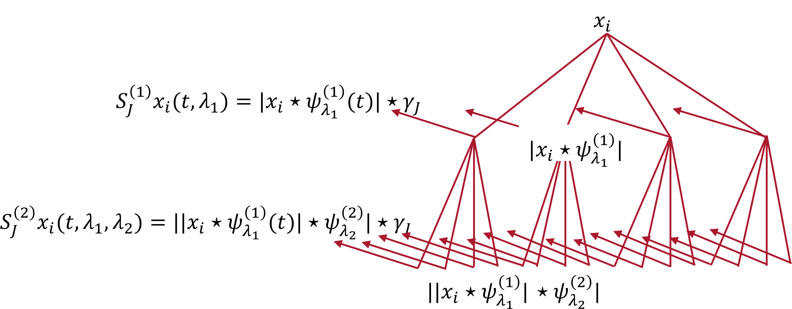
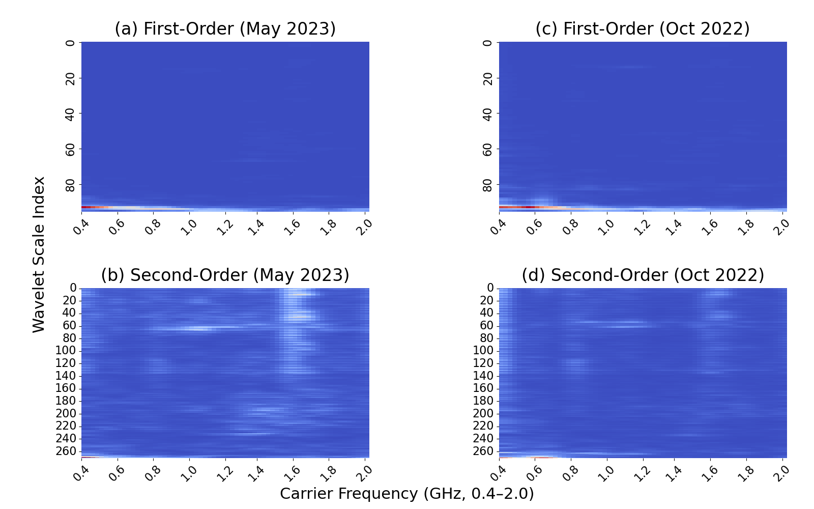
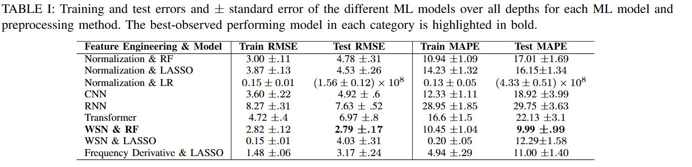

# Towards Intelligent GPR: Wavelet Scattering Networks for Soil Water Content Prediction

Filardi, V., Khosravi Largani, N., Zekavat, S. R., Moradikia, M., Wilson, B., Askari, R., and Mangoubi, O.

*IEEE Transactions on AgriFood Electronics*, 2026.

[Read the paper on IEEE Xplore](https://ieeexplore.ieee.org/abstract/document/11512972/).

## Abstract

This work investigates the development of intelligent Ground Penetrating Radar (GPR) for mapping the received GPR signal features into soil water content (SWC) across multiple depths. To address this, this paper introduces a flexible feature-extraction and machine learning (ML) framework for estimating subsurface SWC at multiple depths from GPR measurements. Specifically, the paper assesses the role of Wavelet Scattering Networks (WSN) data preprocessing for high performance SWC prediction. The proposed methods’ performance is evaluated on in-situ field measurements conducted via an off-the-shelf GPR that transmits multi-carrier signals over 4096 frequency components within the 400 MHz—2 GHz frequency range. The measurements were conducted in the Soilx Lab fields at Worcester Polytechnic Institute (WPI) and are based on loamy soil texture material that is consistent with the topsoil composition of many local farms. Using this data, the performance of different supervised learning models is evaluated, including transformers, deep convolutional neural networks, recurrent neural networks, random forest, linear regression, and LASSO, with diverse signal features extracted from 4096 frequency components. To properly train the ML models, the received GPR signals were labeled via a high-performance moisture probe capable of measuring SWC at different depths. The WSN was deployed as a pre-processing step to extract higher-order derivatives of the attenuation curve, i.e., the received signal power vs. frequency components, enabling high-performance moisture per depth estimation via downstream ML models. We assess the WSN’s performance in predicting multiple root zone SWC by adjusting the filter count and maximum scale of the transform. Additionally, this work determines the most important and optimal number of carrier frequencies required to maintain high prediction accuracy for SWC, aiming to minimize power consumption and the GPR operation speed for scanning all frequency components. Compared to the best-performing benchmark ML model, the proposed WSN feature extraction, paired with a downstream random forest model, achieved 41% higher accuracy with as low as 2.79 SWC RMSE in SWC prediction over four root zone depths. The paper marks an excellent progress toward the implementation of intelligent GPR for megafarm soil subsurface moisture characterization.

## Project workflow


*The workflow combines GPR signal features and moisture probe measurements to train models that estimate soil water content at multiple depths.*

## Wavelet scattering features

The wavelet scattering network convolves the GPR attenuation curve with Morlet wavelets and applies the complex modulus to each response. A low-pass filter averages the modulus outputs to produce the first-order scattering coefficients. The second layer applies another Morlet wavelet convolution and complex modulus to the first-layer modulus outputs before averaging. Low-pass filtering the second-layer outputs gives the second-order scattering coefficients.





*The soil was wetter in October than in May, and the GPR measurements from the two months produced different wavelet scattering features.*

## Running the experiments

### One-time Conda setup

With Conda available in Bash, run this from a fresh checkout:

```bash
bash scripts/setup_soil_2024.sh
```

This creates `soil_2024` from `environment.yml`, installs `akela-shared`
from the checkout, and checks the preprocessing and scikit-learn fitting
imports. Use it when creating a new environment. It leaves an existing
environment of the same name in place. The initial setup needs access to
Conda Forge and PyPI.

The manifest pins Python and the dependencies used by preprocessing and
scikit-learn fitting. Conda selects the platform libraries, including BLAS.
Deep learning also requires PyTorch 2.5.1. Install
the CPU or CUDA build appropriate for your system into `soil_2024`, then
check GPU availability on a GPU compute node if using CUDA:

```bash
conda run -n soil_2024 python -c "import torch; print(torch.__version__, torch.version.cuda, torch.cuda.is_available())"
```

### Shared Python package setup

Feature preprocessing installs the shared package once into the active
`soil_2024` Conda environment. The `smooth_sk_sbatch.sh` and
`smooth_sk_sbatch_subset.sh` submission wrappers also install it once before
their submission loops. The generation-only `smooth_sbatch.sh` wrapper and
generated fitting jobs rely on that environment. When submitting fitting jobs
separately, wait for feature preprocessing to finish or install the package
manually first. Regenerate fitting scripts created with the previous version
to remove their per-job install step.

The deep learning and preprocessing test jobs still use temporary package
installs. Automatic installation uses the local checkout and requires pip,
setuptools 61 or newer, and wheel. The research environment should already
provide NumPy, pandas, and scikit-learn.

For interactive use on the HPC cluster, activate the same Python environment
and run these commands from the repository root.

```bash
python -m pip install --no-deps .
(cd 'Deep learning' && python -c "from akela_shared.csv_loader import load_csv_files; from akela_shared.splitting import stratified_train_test_split_80_20")
```

`--no-deps` keeps the existing research dependencies in place. Pip uses
setuptools in an isolated build environment by default. If the cluster cannot
reach the package index and the active environment already has setuptools 61
or newer and its build requirements, use
`python -m pip install --no-deps --no-build-isolation .`.
Run the install again after pulling changes to `akela_shared`. The install
contains the shared raw CSV loader and split functions. The datasets and
experiment scripts run from the checkout as before.

### Run the SLURM workflows

Run the following commands from the repository root on a SLURM cluster. The job scripts use the original cluster’s Conda setup. Adapt those paths and SLURM settings for your cluster.

1. **Generate the feature datasets.** Submit [feature_datasets.sh](feature_datasets.sh) to run [preprocessing_main.py](preprocessing_main.py). The configuration definitions in [preprocessing_config.py](preprocessing_config.py) select and parameterize transformations from [Data_process.py](Data_process.py). Preprocessing writes the feature datasets and a dated JSON configuration file under `Final_data/`.

   ```bash
   sbatch feature_datasets.sh
   ```

2. **Generate and submit the fitting jobs.** After preprocessing finishes, set `CONFIG_FILE_LOCATION` in [Turing_aboose/smooth_sbatch.sh](Turing_aboose/smooth_sbatch.sh) to the generated JSON file, select the model and its parameter settings, and ensure the configured results directory exists. The wrapper generates SLURM job scripts that call [main_fitting.py](main_fitting.py) for the dataset configurations and selected subsets.

   Set `MODEL_TYPE` to `LinearRegression` for linear regression, `Lasso` for LASSO regression, `RandomForestRegressor` for scikit-learn random forest regression, or `XGBRFRegressor` for XGBoost random forest regression. Each run fits one model type. For `XGBRFRegressor`, supply a matching parameter JSON file. The bundled `xgbregressor_params.json` is configured for boosted-tree `XGBRegressor` runs.

   ```bash
   sbatch Turing_aboose/smooth_sbatch.sh
   ```

   Once the wrapper finishes, submit the generated jobs using the same model name as `MODEL_TYPE` in the wrapper. For example, with its default model:

   ```bash
   python sk_learn_non_stop_sbatch.py --model_type LinearRegression
   ```

3. **Tune and evaluate the models.** The configured split assigns 80% of the selected data to training and 20% to testing. The fitting script selects hyperparameters using cross-validation on the training partition, refits with the selected settings, and evaluates on the held-out test partition. The current fitting script uses leave-one-out cross-validation. The separate Bayesian search helper in [SK_learn_models/SK_bayes_CV.py](SK_learn_models/SK_bayes_CV.py) defaults to five-fold cross-validation for a single group and uses leave-one-group-out cross-validation for multiple groups.

4. **Read the results.** Each model writes a `<ModelType>_results.csv` file in the configured results directory. The `config` column records the preprocessing configuration associated with each result.

### Optional deep learning models

You can also fit a Transformer, a one-dimensional convolutional neural network (CNN), or a GRU-based recurrent neural network (RNN) to predict soil water content from the GPR data. The Transformer uses attention across signal segments, the CNN learns patterns with convolutional filters, and the RNN models the sequence of signal segments with recurrent layers.

From the repository root, enter `Deep learning/` and submit the baseline script for the architecture you want to fit.

| Model | SLURM command |
| --- | --- |
| Transformer | `sbatch tf_baseline.sh` |
| CNN | `sbatch cnn_baseline.sh` |
| RNN | `sbatch rnn_baseline.sh` |

Each script calls [initial_DL_fit.py](Deep%20learning/initial_DL_fit.py) with its model selected through `--nn_model`. The baseline scripts use the `freq_mean_sweep` dataset domain under `Final_data/`.

## Results


